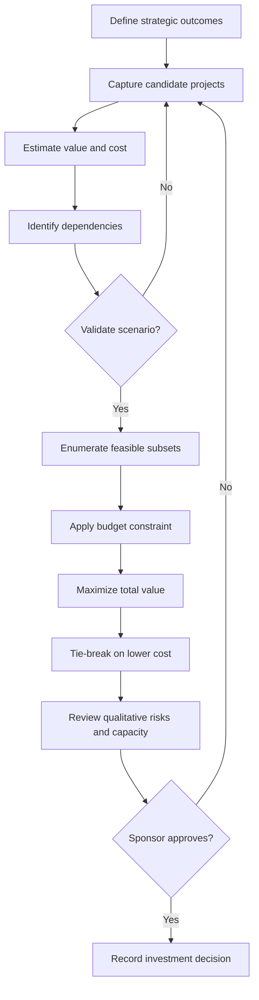

# Investment selection workflow

This is an educational workflow, not an automated funding approval system.

The current `app.py` performs the exact small-scale computation in steps F–I. It does **not** automatically execute or approve projects. The review and authorization steps are governance guidance only.

## Example inputs

Use `examples/sample_portfolio.json` with `python cli.py examples/sample_portfolio.json`. Values are fictional utility points. The solver is exponential and accepts at most 20 candidate projects.
